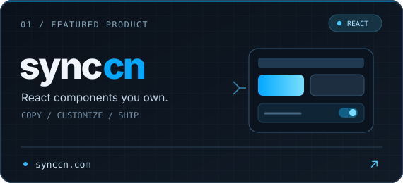
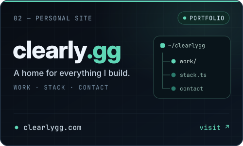

<a href="https://clearlygg.com" title="Visit clearlygg.com">
  
</a>

<p align="center">
  <a href="https://clearlygg.com"></a>
  <a href="https://synccn.com"></a>
  <a href="https://discord.com/users/899624765109702737"></a>
</p>

## <samp>01 // selected_work</samp>

<p align="center">
  <a href="https://synccn.com"></a>
  <a href="https://clearlygg.com"></a>
</p>

- **[synccn](https://synccn.com)** — React + Tailwind components you copy into your project and own outright. No black-box package, every detail is yours to change.
- **[clearly.gg](https://clearlygg.com)** — my corner of the internet: projects, experiments, and the tools I use.

## <samp>02 // toolchain</samp>

<p align="center">
  <sub><samp>LANGUAGES</samp></sub><br />
  
</p>
<p align="center">
  <sub><samp>FRAMEWORKS</samp></sub><br />
  
</p>
<p align="center">
  <sub><samp>TOOLING</samp></sub><br />
  
</p>

## <samp>03 // config</samp>

```ts
export const clearly = {
  role: "self-taught developer",
  focus: ["UI systems", "developer tools", "Roblox engineering"],
  shipping: ["synccn.com", "clearlygg.com"],
  motto: "make it fast. make it useful. make it feel right.",
} as const;
```

## <samp>04 // right_now</samp>

<p align="center">
  <a href="https://discord.com/users/899624765109702737" title="Find me on Discord">
    
  </a>
</p>

<p align="center">
  <sub><samp>git push origin main // keep shipping</samp></sub>
</p>
